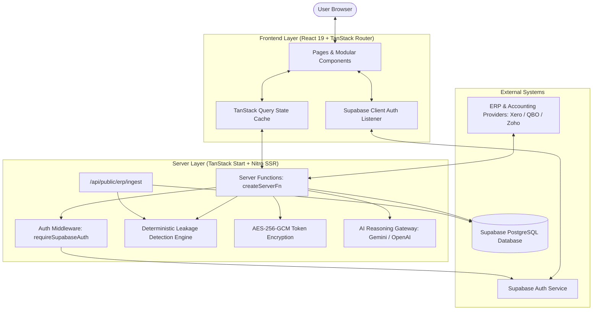
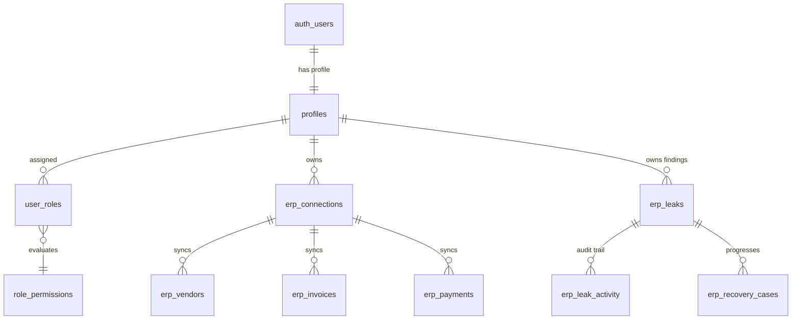

# Auto Audit

> **AI-Powered Financial Leakage Detection & Spend Analytics Platform**

[](https://auto-audit-nu.vercel.app/)
[](https://react.dev/)
[](https://www.typescriptlang.org/)
[](https://vitejs.dev/)
[](https://supabase.com/)
[](https://tailwindcss.com/)

---

## 1. Project Overview

**Auto Audit** is a modern, enterprise-ready web platform engineered to detect, audit, and recover organizational financial leakages across accounting and Enterprise Resource Planning (ERP) systems. 

Modern businesses process thousands of bills, invoices, and payment disbursements across decentralized departments. Without continuous auditing, organizations suffer substantial monetary losses caused by duplicate invoices, erroneous double payments, vendor overpayments, and unapplied credits.

Auto Audit automates the financial audit cycle by ingesting real financial ledgers via standard OAuth connections (such as **Xero**, **QuickBooks Online**, and **Zoho Books**) or direct REST ingestion APIs. The platform applies deterministic audit rule engines and server-side AI reasoning to identify discrepancies, generate tamper-proof audit trails, and manage financial recovery claims through an integrated workflow center.

---

## 2. Project Objectives

- **Automated Discrepancy Detection**: Eliminate slow, error-prone manual spreadsheet audits by automatically discovering duplicate bill entries, duplicate payment transactions, and invoice overpayments.
- **Durable Case Lifecycle Management**: Track identified leakage cases through structured investigation stages (Identified &rarr; Vendor Contacted &rarr; Claim Filed &rarr; Credit Issued &rarr; Recovered).
- **Audit Trail & Accountability**: Provide immutable, append-only activity logging for every status transition, assignee change, and forensic investigation note.
- **Enterprise Multi-Tenant Security**: Protect corporate financial data using PostgreSQL Row Level Security (RLS) and granular Role-Based Access Control (RBAC).
- **Actionable Financial Intelligence**: Deliver executive dashboards, spend concentration analytics, and AI-generated vendor claim notices.

---

## 3. Key Features

| Feature | Description |
| :--- | :--- |
| **Unified Financial Control Center** | Live KPI dashboard presenting total invoiced spend, outstanding balances, at-risk leakage capital, and overall financial health score. |
| **Deterministic Leakage Detection** | Built-in forensic rule engines for duplicate invoices, duplicate payment references, invoice overpayments, and overdue liabilities. |
| **Durable Leaks Register** | Interactive register to triage findings with multi-criteria filtering (status, severity, type, assignee), full-text search, and CSV export. |
| **Recovery Center & Kanban Pipeline** | Visual recovery lifecycle tracker to manage vendor claims, record credit notes, and log recovered cash. |
| **ERP & Accounting Connectors** | OAuth 2.0 connectivity for Xero, QuickBooks Online, and Zoho Books, with automatic synchronization of vendors, invoices, and payments. |
| **Direct REST Ledger Ingestion** | Secure endpoint (`/api/public/erp/ingest`) allowing legacy ERP and custom accounting software to push JSON ledgers directly. |
| **Role-Based Access Control (RBAC)** | Fine-grained permission matrix supporting 7 distinct roles (`admin`, `cfo`, `finance_manager`, `accountant`, `procurement_manager`, `auditor`, `viewer`) and 10 operational permissions. |
| **Team Member Administration** | Workspace member management allowing administrators to invite teammates, assign roles, suspend logins, and monitor activity. |
| **AI Spend Analytics & Dispute Generation**| Server-side AI models (Google Gemini, Google Vertex AI, or OpenAI) to generate structured leakage assessments and draft formal vendor dispute notices. |
| **Unified Ledger & Transaction Reports**| Consolidated transactions view combining bills, invoices, and disbursements, with live board-ready CSV report generation. |

---

## 4. Technologies Used

### Frontend & Client Framework
- **React 19 (`react` v19.2.0, `react-dom` v19.2.0)**: Modern component architecture utilizing concurrent features and server function bridges.
- **TypeScript (`typescript` v5.8.3)**: Strict static type safety throughout application routes, database schemas, and data ingestion pipelines.
- **TanStack Router (`@tanstack/react-router` v1.170.18)**: Type-safe file-based client-side routing.
- **TanStack Query (`@tanstack/react-query` v5.101.1)**: Asynchronous server-state synchronization, cache management, and optimistic UI mutations.
- **TailwindCSS v4 (`@tailwindcss/vite`, `tailwindcss` v4.2.1)**: Utility-first design system with responsive layouts and dark/light mode presentation.
- **Radix UI & shadcn/ui Primitives**: Accessible dialogs, drawers, dropdown menus, tabs, and select components.
- **Recharts (`recharts` v2.15.4)**: Interactive financial data visualizations (trend area charts, breakdown pies, and radar charts).
- **Lucide React (`lucide-react` v0.575.0)**: Modern iconography.
- **Sonner (`sonner` v2.0.7)**: Notification toasts for user feedback.

### Backend, Server & Database
- **TanStack Start (`@tanstack/react-start` v1.168.32)**: Full-stack server function runtime supporting type-safe remote procedure calls (`createServerFn`).
- **Nitro (`nitro` v3.0.260603-beta)**: High-performance universal server engine compiling SSR handlers and API routes.
- **Vite 8 (`vite` v8.2.1)**: Next-generation fast frontend bundler.
- **Supabase (`@supabase/supabase-js` v2.117.1)**: Cloud PostgreSQL database, user authentication, session token handling, and Row Level Security.
- **Vercel AI SDK (`ai` v7.0.107, `@ai-sdk/google`, `@ai-sdk/openai`)**: Structured AI inference and prompt orchestration.
- **Node.js Crypto (`node:crypto`)**: AES-256-GCM symmetric encryption for ERP access tokens at rest.

---

## 5. System Architecture



---

## 6. Backend Architecture

The backend of Auto Audit is designed around **Server Functions (`createServerFn`)** and **Nitro Server Handlers**, providing distinct architectural benefits:

1. **Zero Secret Leakage**: All database queries utilizing the Supabase Service Role key, external OAuth client secrets, and token decryption routines run exclusively on the server. No credentials ever reach the client bundle.
2. **Deterministic Rules + AI Layering**: 
   - *Phase 1*: Fast in-memory algorithmic scans on ingested invoices and payments detect explicit duplicate hashes and threshold overpayments.
   - *Phase 2*: Findings are idempotently stored into `erp_leaks` using unique `(user_id, fingerprint)` constraints.
   - *Phase 3*: Optional LLM inference generates executive risk summaries and vendor recovery claim letters.
3. **Atomic Audit Logging**: Status transitions and assignee modifications record append-only rows in `erp_leak_activity` to preserve chain-of-custody for financial auditors.
4. **Credential Cryptography**: OAuth refresh and access tokens for external accounting systems are encrypted at rest using `AES-256-GCM` before being written to `erp_connections`.

---

## 7. Database Overview

Auto Audit utilizes Supabase PostgreSQL with explicit schema relationships and Row Level Security on every table:



### Core Database Tables

| Table Name | Description | RLS Policy |
| :--- | :--- | :--- |
| `public.profiles` | Stores user profiles (name, email, department, company, status). | Users manage own profile (`auth.uid() = id`); admins manage all. |
| `public.user_roles` | Associates users with their functional platform role. | Users read own role; admins manage all. |
| `public.role_permissions` | Defines allowed capabilities per role. | Readable by all authenticated users; edited by admins. |
| `public.erp_connections` | Holds connected ERP provider details and encrypted credentials. | Strictly scoped to owning user (`auth.uid() = user_id`). |
| `public.erp_provider_config` | Stores developer OAuth client credentials for Xero/QBO/Zoho. | Server-only (`false` for authenticated); managed via service role. |
| `public.erp_oauth_states` | Short-lived cryptographic state tokens for OAuth CSRF protection. | Server-only (`false` for authenticated). |
| `public.erp_vendors` | Ingested supplier directory records with contact info and spend stats. | User-scoped (`auth.uid() = user_id`). |
| `public.erp_invoices` | Ingested vendor bills and invoices (dates, amounts, status). | User-scoped (`auth.uid() = user_id`). |
| `public.erp_payments` | Ingested disbursements and payment allocations. | User-scoped (`auth.uid() = user_id`). |
| `public.erp_sync_runs` | Sync execution history with record count telemetry. | User-scoped (`auth.uid() = user_id`). |
| `public.erp_leaks` | Durable financial leakage findings with severity and lifecycle status. | User-scoped (`auth.uid() = user_id`). |
| `public.erp_leak_activity` | Append-only audit log tracking changes, notes, and actions on leaks. | Readable by case owner (`auth.uid() = user_id`). |
| `public.erp_recovery_cases` | Active recovery claims, stage tracking, and recovered amounts. | User-scoped (`auth.uid() = user_id`). |

---

## 8. Authentication and Authorization

### Authentication
- Built on **Supabase Auth** (`@supabase/supabase-js`).
- Supports email and password authentication with client-side trimming, email formatting validation, and error alert banners.
- Password recovery flow with secure token exchange (`/forgot-password`).
- Email verification resend functionality (`/verify-email`).
- Global session revocation (`/security`) allowing users to terminate active refresh tokens across all devices simultaneously.

### Role-Based Authorization
Permissions are enforced at two levels:
1. **Frontend Route & UI Gates**: The `<PermissionGate permission="...">` component conditionally renders controls based on the signed-in user's active permissions.
2. **Server-Side Enforcement**: Server functions verify session JWTs and evaluate `requirePermission(context, permission)` or `requireAdmin(context)` before modifying any database table.

---

## 9. Project Folder Structure

```
Auto_audit/
├── .env.example               # Template of all public and server environment variables
├── .gitignore                 # Git ignore rules (node_modules, .output, .vercel)
├── AGENTS.md                  # Developer guidelines and architectural constraints
├── package.json               # Project manifest, dependencies, and build scripts
├── tsconfig.json              # TypeScript compilation configuration
├── vite.config.ts             # Clean Vite + TanStack Start + Nitro configuration
├── public/                    # Static favicon and public assets
├── src/
│   ├── components/
│   │   ├── common/            # Data tables, headers, permission gates, badges
│   │   ├── dashboard/         # Financial chart widgets
│   │   ├── erp/               # Connection dialogs, OAuth wizards, sync dashboard
│   │   ├── layout/            # Navigation bar, sidebar, app shell, auth layout
│   │   ├── leaks/             # Leak investigation drawer and status controls
│   │   ├── legal/             # Cookie banner and legal presentation
│   │   └── ui/                # UI primitives (buttons, dialogs, inputs, tabs)
│   ├── constants/             # Navigation configurations and role mappings
│   ├── data/                  # Static fallback mock datasets
│   ├── hooks/                 # React Query hooks (ERP, notifications, mobile)
│   ├── integrations/
│   │   └── supabase/          # Supabase browser client, server client, middleware
│   ├── lib/
│   │   ├── account.functions.ts  # Profile updates and user status lookups
│   │   ├── admin.functions.ts    # User management, roles, and permission matrix
│   │   ├── erp.functions.ts      # ERP connection and sync dispatchers
│   │   ├── leak.functions.ts     # Leak case mutations and recovery workflows
│   │   ├── notifications.functions.ts # Live notification query aggregation
│   │   └── erp/
│   │       ├── ai-analysis.server.ts     # AI leakage analysis engine
│   │       ├── crypto.server.ts          # AES-256-GCM token encryption
│   │       ├── data.server.ts            # Rule-based leak detection algorithms
│   │       ├── fingerprint.server.ts     # Deterministic SHA-256 fingerprinting
│   │       ├── leak-persistence.server.ts# Idempotent leak persistence engine
│   │       ├── leak-workflow.server.ts   # Recovery case state machine
│   │       ├── oauth.server.ts           # OAuth token handling
│   │       ├── providers.ts              # ERP provider metadata
│   │       ├── service.server.ts         # ERP orchestration engine
│   │       └── sync.server.ts            # Provider API sync routines
│   ├── providers/             # MockAuth context and Theme provider
│   ├── routes/                # TanStack file-based application routes
│   │   ├── _shell/            # Authenticated application modules
│   │   ├── api/               # Server-side API endpoints (OAuth callback, Ingest)
│   │   ├── login.tsx          # Login page
│   │   ├── register.tsx       # Registration page
│   │   └── forgot-password.tsx# Password reset page
│   └── styles.css             # TailwindCSS v4 theme styles
└── supabase/
    ├── config.toml            # Supabase CLI project configuration
    └── setup_new_database.sql # Complete idempotent database setup script
```

---

## 10. Installation and Setup Instructions

### Prerequisites
- **Node.js**: `v20.x` or `v22.x` (LTS recommended)
- **npm**: `v10.x` or higher
- **Git**

### Step-by-Step Installation

1. **Clone the repository**:
   ```bash
   git clone https://github.com/palak2309/Auto_audit.git
   cd Auto_audit
   ```

2. **Install project dependencies**:
   ```bash
   npm install
   ```

3. **Set up environment variables**:
   Copy the `.env.example` template to `.env`:
   ```bash
   cp .env.example .env
   ```
   Open `.env` and fill in your Supabase project credentials as detailed in Section 11.

---

## 11. Environment Variables

The table below describes all environment variables used by Auto Audit. **Never commit actual secret values or keys to source control.**

| Variable Name | Environment | Required | Description | Example Format |
| :--- | :--- | :---: | :--- | :--- |
| `VITE_SUPABASE_URL` | Client (Browser) | **Yes** | Your Supabase Project HTTPS URL | `https://xyzproject.supabase.co` |
| `VITE_SUPABASE_ANON_KEY` | Client (Browser) | **Yes** | Your Supabase Public / Anon API Key | `eyJhbGciOi...` |
| `SUPABASE_URL` | Server (Nitro) | **Yes** | Matches your Supabase Project URL | `https://xyzproject.supabase.co` |
| `SUPABASE_ANON_KEY` | Server (Nitro) | **Yes** | Matches your Supabase Anon Key | `eyJhbGciOi...` |
| `SUPABASE_SERVICE_ROLE_KEY` | Server (Nitro) | **Yes** | Secret Service Role Key (bypasses RLS for admin tasks) | `eyJhbGciOi...` |
| `ERP_TOKEN_ENCRYPTION_KEY` | Server (Nitro) | **Yes** | 32-byte hex key for AES-256 token encryption | `64 character hex string` |
| `GEMINI_API_KEY` | Server (Nitro) | Optional | Google Gemini API Key for AI Spend Analytics | `AIzaSy...` |
| `OPENAI_API_KEY` | Server (Nitro) | Optional | Alternative OpenAI Key for AI Analysis | `sk-proj-...` |

> **Generating the Encryption Key**:
> You can generate a random 32-byte hex key by running:
> ```bash
> node -e "console.log(require('crypto').randomBytes(32).toString('hex'))"
> ```

---

## 12. Running the Project Locally

To start the local development server with Hot Module Replacement (HMR):

```bash
npm run dev
```

The application will start at:
```
http://localhost:3000
```

---

## 13. Build and Deployment Instructions

### Production Build
To compile the client bundle and server functions for production:

```bash
npm run build
```

This compiles:
- The optimized client-side SPA assets into `.output/public/`
- The Nitro server worker and SSR entry points into `.output/server/`

### Preview Production Build Locally
To test the built artifacts locally before deploying:

```bash
npm run preview
```

### Vercel Deployment
1. Import the repository into [Vercel](https://vercel.com).
2. Set the Framework Preset to **Vite** (or Other).
3. In **Project Settings &rarr; Environment Variables**, configure:
   - `VITE_SUPABASE_URL`
   - `VITE_SUPABASE_ANON_KEY`
   - `SUPABASE_URL`
   - `SUPABASE_ANON_KEY`
   - `SUPABASE_SERVICE_ROLE_KEY`
   - `ERP_TOKEN_ENCRYPTION_KEY`
   - `GEMINI_API_KEY` (Optional)
4. Deploy the project.

---

## 14. Supabase Configuration

1. Log in to the [Supabase Dashboard](https://supabase.com/dashboard) and select or create your project.
2. Open the **SQL Editor** tab.
3. Open [`supabase/setup_new_database.sql`](./supabase/setup_new_database.sql), copy its entire contents, and execute the query.
   - This script creates all 13 necessary tables (`profiles`, `user_roles`, `role_permissions`, `erp_connections`, `erp_invoices`, `erp_payments`, `erp_vendors`, `erp_leaks`, `erp_recovery_cases`, etc.).
   - It configures Row Level Security (RLS) policies and the initial user registration trigger.
4. Under **Authentication &rarr; URL Configuration**:
   - Set **Site URL** to: `https://auto-audit-nu.vercel.app`
   - Add **Redirect URLs**:
     - `https://auto-audit-nu.vercel.app/**`
     - `http://localhost:3000/**`

---

## 15. GitHub Repository

- **Repository**: [https://github.com/palak2309/Auto_audit](https://github.com/palak2309/Auto_audit)
- **Branch**: `main` / `master`

---

## 16. Live Website

- **Production URL**: [https://auto-audit-nu.vercel.app/](https://auto-audit-nu.vercel.app/)
- **Login Portal**: [https://auto-audit-nu.vercel.app/login](https://auto-audit-nu.vercel.app/login)

---

## 17. Future Scope

- **Enterprise Connectors**: Native API integration with SAP S/4HANA, Oracle NetSuite, and Microsoft Dynamics 365.
- **Contract OCR & Rate Card Parsing**: Ingestion of PDF vendor contracts to automatically detect contract price discrepancy leakages.
- **Automated ACH Payment Hold Webhooks**: Webhook callbacks to banking APIs to pause flagged duplicate disbursements prior to batch settlement.
- **Multi-Factor TOTP Enforcement**: Complete integration of Supabase MFA TOTP enrollment and challenge verification.
- **Multi-Currency Hedging Analysis**: Real-time foreign exchange anomaly detection for international multi-currency suppliers.

---

## 18. Contributors

- **Palak Pathan** ([@palak2309](https://github.com/palak2309)) — *Lead Developer & Architect*

*(Additional academic contributors and project guides can be added here upon confirmation).*

---

## 19. Acknowledgement

Special thanks to the open-source communities behind **React**, **TanStack Start**, **Vite**, **Supabase**, and **TailwindCSS** for providing the foundational tools that made the development of Auto Audit possible.
